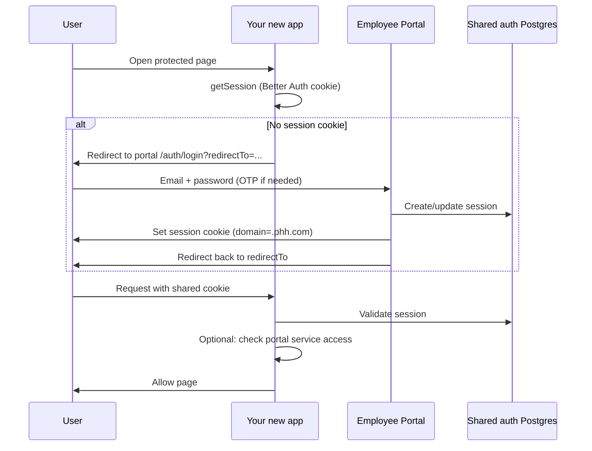

# Authenticate a New Application with Employee Portal

Step-by-step guide for wiring a **new app** into the PHH shared login (Better Auth SSO), the same model used by **PHH-DRIVE**, **docs**, **OAI Order Sender**, and related tools.

Related docs:

- [shared-auth-sso.md](./shared-auth-sso.md) — env contract across existing apps
- [ecosystem-architecture-and-test-guide.md](./ecosystem-architecture-and-test-guide.md) — architecture overview
- [drive-media-integration.md](./drive-media-integration.md) — Drive API keys (separate from user SSO)

---

## 1. How authentication works

Employee Portal is the **identity provider**. Users sign in once at the portal. Sibling apps on the **same cookie domain** reuse that session.



**What must be shared across apps**

| Piece | Why |
|-------|-----|
| `BETTER_AUTH_SECRET` | Same signing secret so all apps accept the same session tokens |
| `AUTH_DATABASE_URL` | Same Postgres that holds Better Auth `user` / `session` / `account` / `verification` |
| `AUTH_COOKIE_DOMAIN` | e.g. `.phh.com` or `.local.test` so the cookie is sent to every subdomain |
| Session timing vars | Keep `AUTH_SESSION_*` in sync with the portal |
| Parent domain DNS + reverse proxy | Apps must be reachable as sibling hosts under that cookie domain |

**What stays per-app**

| Piece | Example |
|-------|---------|
| App’s own `ORIGIN` | `https://myapp.phh.com` |
| App’s own product database | `DATABASE_URL` for your CMS / app data |
| Optional `PORTAL_DATABASE_URL` | Read portal `user_profile` / `service` / roles for access checks |

Login UI lives **only on the portal**. Sibling apps should **not** implement their own email/password signup against a separate auth DB.

---

## 2. Choose an integration style

### Style A — Full SSO sibling (recommended for SvelteKit apps)

Copy the pattern used by **docs** / **drive**:

1. Better Auth client in your app pointed at the **shared auth DB** + same secret + same cookie domain.
2. `hooks.server.ts` loads `event.locals.user` via `auth.api.getSession`.
3. Unauthenticated users redirect to portal login with `redirectTo` set to the current absolute URL.
4. Optionally query portal Postgres to enforce **Tools service** access (like docs admin).

Use this when your app is first-party, runs on a sibling subdomain, and needs real user identity.

### Style B — Portal-only login + service link (thin app)

If the app is mostly public or embeds behind the portal:

1. Register the app URL as a **Tools service** on the portal.
2. Add the origin to portal `PORTAL_TRUSTED_REDIRECT_ORIGINS` (and/or a dedicated `*_ORIGIN` env if you make it a builtin).
3. Users open the tile from the portal after signing in.
4. Your app still needs Style A session reading if it has its own protected routes.

### Style C — Server-to-server (not user SSO)

API keys (`znldv_` / `znltv_`) are for Drive and backends. They are **not** a substitute for user login. See Drive authentication docs and [drive-media-integration.md](./drive-media-integration.md).

This guide focuses on **Style A**.

---

## 3. Prerequisites (ops / infra)

Before writing code:

1. **Pick a public hostname** under the shared parent domain  
   - Prod example: `https://myapp.phh.com`  
   - Local example: `http://myapp.local.test`

2. **DNS / hosts**  
   - Prod: DNS A/CNAME for `myapp.phh.com`  
   - Local: add hosts entry (portal has `scripts/setup-local-sso-hosts.ps1` — extend it or add manually)

3. **Reverse proxy**  
   - Prod: nginx (or Caddy) → your container/port  
   - Local: extend employee-portal Caddy (see [shared-auth-sso.md](./shared-auth-sso.md))

4. **Cookie domain** must match the parent of portal + your app  
   - `AUTH_COOKIE_DOMAIN=.phh.com` for `phh.com` + `myapp.phh.com`  
   - Never use `localhost` ports for SSO — cookies will not share across apps

5. Get these values from the portal team (must match portal exactly):

   - `BETTER_AUTH_SECRET`
   - `AUTH_DATABASE_URL` (portal Postgres)
   - `AUTH_COOKIE_DOMAIN`
   - `AUTH_SESSION_EXPIRES_IN` / `AUTH_SESSION_UPDATE_AGE` / `AUTH_SESSION_COOKIE_CACHE_*`
   - Portal public URL → your `PORTAL_ORIGIN`

---

## 4. Portal-side setup (do this in parallel with app work)

### Step 4.1 — Trust your app’s origin for CSRF + post-login redirects

On **employee-portal**, either:

**Option 1 (quick):** add to `.env`:

```env
PORTAL_TRUSTED_REDIRECT_ORIGINS=https://myapp.phh.com
```

Comma-separate multiple origins. Portal also auto-trusts known `*_ORIGIN` vars (Drive, Docs, etc.).

**Option 2 (builtin-style):** add a dedicated env such as `MYAPP_ORIGIN` and wire it in:

- `src/env.ts` (declare the private env)
- `src/lib/server/auth-trusted-origins.ts` (`addOrigin(trusted, MYAPP_ORIGIN)`)
- Optionally `src/lib/server/services/builtin-service.ts` to upsert a Tools tile from that URL

Redeploy / restart the portal after changing trusted origins.

### Step 4.2 — Create a Tools service tile

Users discover your app from **Services / Tools**.

**Manual (common for one-off apps):**

1. Sign in to the portal as admin.
2. **Tools → Manage → Services** (or equivalent admin UI): create a service.
3. Set **Link** to your public origin (e.g. `https://myapp.phh.com`).
4. Copy the service **UUID** — your app will use it for access checks (`PORTAL_SERVICE_ID` or a constant like docs’ `DOCS_SERVICE_ID`).

**Builtin (long-lived first-party apps):** follow Drive/Docs: stable UUID in `builtin-services.ts` + upsert from `MYAPP_ORIGIN` on portal startup.

### Step 4.3 — Grant access roles

1. Portal **Settings → Access roles**.
2. Assign your new **service** to the roles that should use the app.
3. Assign those roles to users (department matrix / user management).

**Access rules used by sibling apps (docs pattern):**

| Condition | Result |
|-----------|--------|
| `user_profile.portal_role = 'admin'` | Allow |
| Service `is_public = true` | Allow any signed-in user |
| User’s access role includes the service | Allow |
| Otherwise | Deny (403) |

### Step 4.4 — Confirm login redirect allowlist

After login, portal only redirects to:

- Relative portal paths (`/dashboard`, …), or
- Absolute URLs whose **origin** is in `getAuthTrustedOrigins()`

If `redirectTo` is wrong or untrusted, users land on `/dashboard` instead of your app.

---

## 5. Application-side setup (your new app)

Assume a **SvelteKit** app (same stack as docs/drive). Adapt names if you use another framework — the cookie + shared DB contract is the same.

### Step 5.1 — Environment variables

Create `.env` (never commit secrets):

```env
# Your public URL — must match the browser address bar exactly
ORIGIN=https://myapp.phh.com

# Where users go to sign in
PORTAL_ORIGIN=https://phh.com

# Shared SSO (identical to portal)
BETTER_AUTH_SECRET=<same as portal>
AUTH_DATABASE_URL=<portal postgres URL>
AUTH_COOKIE_DOMAIN=.phh.com
AUTH_SESSION_EXPIRES_IN=7d
AUTH_SESSION_UPDATE_AGE=30m
AUTH_SESSION_COOKIE_CACHE_ENABLED=false
AUTH_SESSION_COOKIE_CACHE_MAX_AGE=30m

# Optional but recommended for permission checks
PORTAL_DATABASE_URL=<same as AUTH_DATABASE_URL or portal DB>

# Your app’s own data
DATABASE_URL=<your app postgres>

# Service UUID from Step 4.2
PORTAL_SERVICE_ID=<uuid-from-portal-tools-service>

# Behind TLS reverse proxy (adapter-node)
PROTOCOL_HEADER=x-forwarded-proto
HOST_HEADER=x-forwarded-host
```

**Local SSO example**

```env
ORIGIN=http://myapp.local.test
PORTAL_ORIGIN=http://portal.local.test
AUTH_COOKIE_DOMAIN=.local.test
BETTER_AUTH_SECRET=<same as portal>
AUTH_DATABASE_URL=<portal postgres>
PORTAL_DATABASE_URL=<portal postgres>
PORTAL_SERVICE_ID=<uuid>
DATABASE_URL=postgres://.../myapp
```

Browse via the named host (Caddy), **not** `http://localhost:PORT`.

### Step 5.2 — Shared auth schema + DB client

Point a Drizzle (or SQL) client at `AUTH_DATABASE_URL` and use the Better Auth tables (`user`, `session`, `account`, `verification`). Copy from `docs/src/lib/server/db/auth.schema.ts` / `auth-db.ts` or `drive` equivalents — do **not** create a second auth user table.

### Step 5.3 — Better Auth instance (session reader)

Sibling apps typically configure Better Auth as a **session consumer** (no email/password plugins — portal owns login):

```ts
// src/lib/server/auth.ts (simplified — mirror docs)
import { betterAuth } from 'better-auth/minimal';
import { drizzleAdapter } from 'better-auth/adapters/drizzle';
import { sveltekitCookies } from 'better-auth/svelte-kit';
import { getRequestEvent } from '$app/server';
import { authDb } from '$lib/server/db/auth-db';
import { getAuthSessionOptions } from '$lib/server/auth-session-config';
import { getConfiguredOrigin } from '$lib/server/public-origin';

const { session, advanced } = getAuthSessionOptions(); // must mirror portal cookie domain + timings

export const auth = betterAuth({
	baseURL: getConfiguredOrigin()!,
	secret: process.env.BETTER_AUTH_SECRET!,
	session,
	advanced,
	database: drizzleAdapter(authDb, { provider: 'pg', schema: { /* user, session, account, verification */ } }),
	plugins: [sveltekitCookies(getRequestEvent)]
});
```

Copy `auth-session-config.ts` from docs/drive so `AUTH_COOKIE_DOMAIN` enables `crossSubDomainCookies`.

### Step 5.4 — Populate `locals.user` in hooks

```ts
// hooks.server.ts (simplified)
const session = await auth.api.getSession({ headers: event.request.headers });
if (session) {
	event.locals.session = session.session;
	event.locals.user = session.user;
}
```

### Step 5.5 — Redirect unauthenticated users to the portal

Build a portal login URL with **absolute** `redirectTo`:

```ts
// src/lib/server/portal-origin.ts
export function portalLoginUrl(returnTo?: string): string {
	const portal = process.env.PORTAL_ORIGIN!.replace(/\/$/, '');
	const url = new URL('/auth/login', portal);
	url.searchParams.set('redirectTo', returnTo ?? `${process.env.ORIGIN}/`);
	return url.toString();
}
```

Guard private routes:

```ts
if (!event.locals.user) {
	throw redirect(
		303,
		portalLoginUrl(`${origin}${event.url.pathname}${event.url.search}`)
	);
}
```

### Step 5.6 — Enforce portal service access (recommended)

Query portal DB (same pattern as `docs/src/lib/server/portal-access.ts`):

1. If `user_profile.portal_role === 'admin'` → allow.
2. Else load `service` by `PORTAL_SERVICE_ID`; if missing → deny; if `is_public` → allow.
3. Else check `user_department_role` ⨝ `access_role_service` for that `service_id`.

Return **403** when signed in but not assigned — do not silently treat as logged out.

### Step 5.7 — Optional “Sign in with portal” page

If someone hits `/auth/login` on your app, show a single button linking to `portalLoginUrl(...)` (see `docs/src/routes/auth/login`). Do not collect passwords locally.

### Step 5.8 — Logout

Prefer portal logout so the shared cookie is cleared for all apps. If your app exposes logout, call Better Auth sign-out against the shared session (and ideally redirect to portal logout as well). Coordinate with the portal team so users are not left half-logged-in on sibling hosts.

---

## 6. End-to-end checklist

### Portal

- [ ] App origin listed in `PORTAL_TRUSTED_REDIRECT_ORIGINS` and/or a dedicated `*_ORIGIN` wired into `auth-trusted-origins.ts`
- [ ] Tools **service** created (or builtin upserted); link points at your `ORIGIN`
- [ ] Access role(s) include that service; test user has that role
- [ ] Portal restarted/redeployed after env changes
- [ ] DNS / nginx (or Caddy) routes your hostname to the app

### Your app

- [ ] `ORIGIN` matches the browser URL (scheme + host + port if any)
- [ ] `PORTAL_ORIGIN` points at the real portal
- [ ] `BETTER_AUTH_SECRET`, `AUTH_DATABASE_URL`, `AUTH_COOKIE_DOMAIN`, session vars match portal
- [ ] Better Auth + hooks load session into `locals.user`
- [ ] Protected routes redirect to `/auth/login?redirectTo=<absolute-url>`
- [ ] Access check uses `PORTAL_SERVICE_ID` + portal DB
- [ ] App reachable on the shared parent domain (not raw localhost)

### Smoke test

1. Clear cookies for the parent domain.
2. Open `https://myapp.phh.com/protected` → should redirect to portal login.
3. Sign in → should return to `/protected` with a session.
4. Open portal in another tab → already signed in.
5. User **without** the service role → 403 on your app (if you enforce Step 5.6).
6. Admin user → allowed.

---

## 7. Local development walkthrough

1. Extend hosts so `myapp.local.test` resolves (and portal/drive/docs hosts exist).
2. In **employee-portal** `.env`:

   ```env
   PORTAL_TRUSTED_REDIRECT_ORIGINS=http://myapp.local.test
   # plus Caddy upstream for your app if you add a site block
   ```

3. Start portal (+ Caddy), then your app with local SSO env from Step 5.1.
4. Browse `http://portal.local.test` and `http://myapp.local.test` only — avoid `localhost:port`.

See [shared-auth-sso.md](./shared-auth-sso.md) for the existing local Caddy workflow.

---

## 8. Production deployment notes

1. Deploy your container; put TLS termination on nginx/Caddy.
2. Set `ORIGIN=https://myapp.phh.com` (HTTPS).
3. Keep `AUTH_COOKIE_DOMAIN=.phh.com` (leading dot).
4. Ensure portal `PORTAL_TRUSTED_REDIRECT_ORIGINS` includes `https://myapp.phh.com` (http alternate is added automatically by portal trusted-origin helpers when the https origin is listed).
5. Confirm the app container can reach **portal Postgres** (`AUTH_DATABASE_URL` / `PORTAL_DATABASE_URL`) on the private network.
6. Grant Access roles before announcing the app to users.

UAT typically uses hosts like `*.uat.phh.com` with `AUTH_COOKIE_DOMAIN=.uat.phh.com` — keep portal and app on the **same** UAT parent domain.

---

## 9. Troubleshooting

| Symptom | Likely cause | Fix |
|---------|--------------|-----|
| Login **400** / Invalid origin | Browser host not in portal `trustedOrigins` | Use the configured `ORIGIN` host; add app to trusted origins |
| Login succeeds but returns to portal dashboard | `redirectTo` origin not trusted | Add your origin to `PORTAL_TRUSTED_REDIRECT_ORIGINS` |
| Session on portal but not on your app | Different cookie domain / secret / auth DB | Align `AUTH_COOKIE_DOMAIN`, `BETTER_AUTH_SECRET`, `AUTH_DATABASE_URL` |
| Cookie missing on HTTP | `Secure` cookies on plain HTTP | Use HTTPS or local `.local.test` HTTP with secure cookies disabled when origin is http |
| Browsing `localhost:port` breaks SSO | Cookie domain does not cover localhost | Always use sibling `*.local.test` via Caddy |
| **403** after login | Service not assigned to user’s role | Settings → Access roles; or make service public; admins bypass |
| **503** verifying access | App cannot reach portal Postgres | Fix `PORTAL_DATABASE_URL` / network / firewall |
| Two different users across apps | Separate auth databases | Point all apps at portal `AUTH_DATABASE_URL` only |

---

## 10. Reference: minimal SQL for access checks

Replace `$2` with your service UUID:

```sql
-- Admin bypass
SELECT portal_role FROM user_profile WHERE user_id = $1;

-- Service public flag
SELECT is_public FROM service WHERE id = $2;

-- Role assignment
SELECT 1
FROM user_department_role udr
INNER JOIN access_role_service ars ON ars.role_id = udr.role_id
WHERE udr.user_id = $1 AND ars.service_id = $2
LIMIT 1;
```

---

## 11. What not to do

- Do not run a separate Better Auth database per app for PHH users.
- Do not set different `BETTER_AUTH_SECRET` values per app.
- Do not rely on `localhost` ports for cross-app login.
- Do not implement a second password login UI in the sibling app.
- Do not skip trusted-origin registration if you need `redirectTo` back to your app.
- Do not confuse **Drive API keys** with **user SSO** — keys authenticate servers; cookies authenticate people.

---

## 12. Suggested implementation order

1. Infra: hostname + proxy + cookie domain agreement  
2. Portal: trusted origin + Tools service + access role  
3. App: env + auth DB client + Better Auth + hooks  
4. App: login redirect + protected layout  
5. App: portal service access check  
6. Smoke test (Section 6)  
7. Document your app’s `ORIGIN` / `PORTAL_SERVICE_ID` in your repo’s README and link back to this guide  

When in doubt, copy **docs** (`docs/src/lib/server/auth.ts`, `portal-origin.ts`, `portal-access.ts`, `auth-guards.ts`) and rename the service ID.
